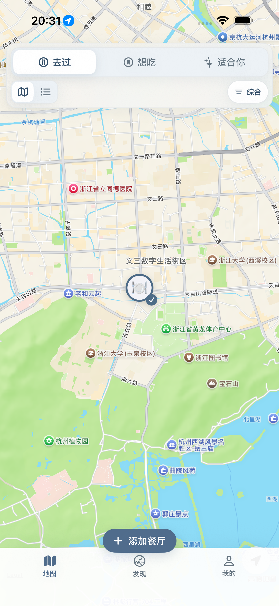
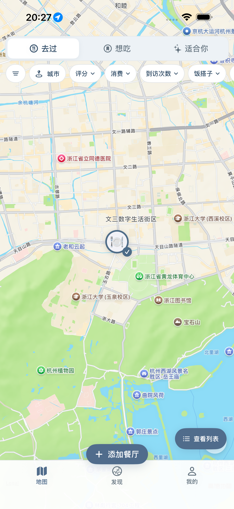
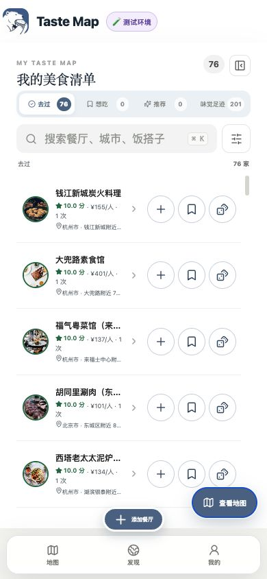
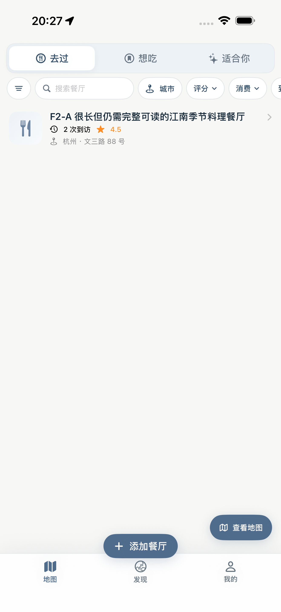
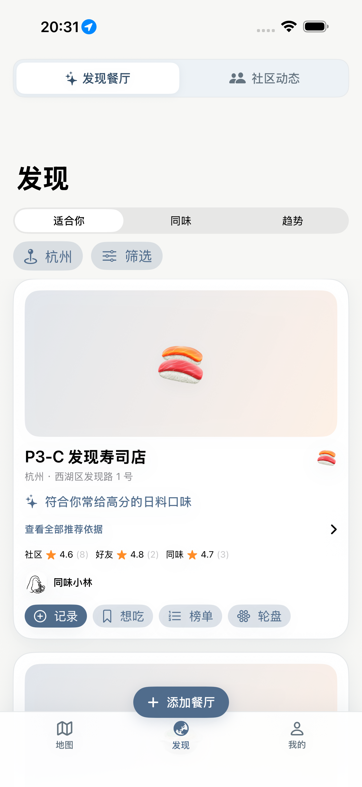
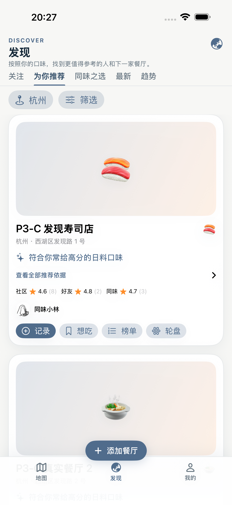
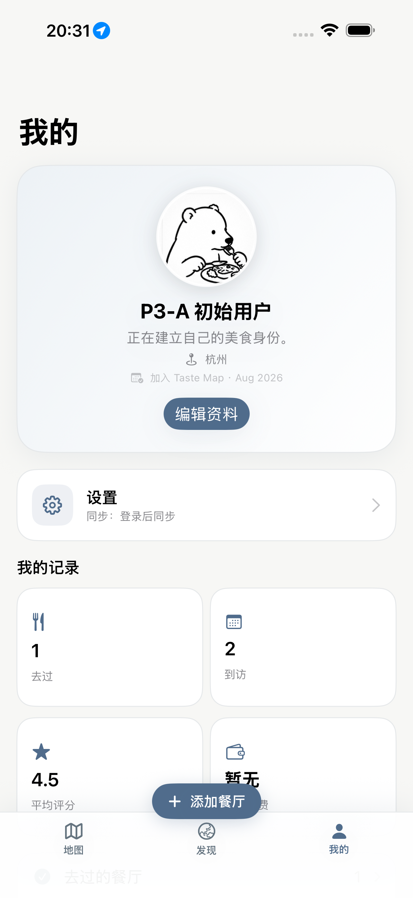
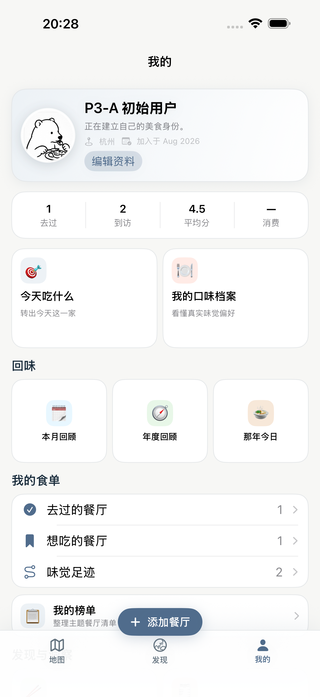

# Taste Map｜Map + Discovery + Profile 产品/布局 Parity 验收报告

日期：2026-08-30  
分支：`fix/core-product-layout-parity`  
基线：`origin/main@2b7ffa8c8ac6d7c83099c3f45a4eed16bee0d620`（包含真机 Sync pull timeout 修复）  
工作目录：`/Users/lafayette/Projects/private-food-map-core-parity`

## 1. 范围与安全边界

本次只修改以下产品/布局范围：

- Map / List 主界面
- Discovery / 发现
- Profile / 我的
- 上述页面所需的 DEBUG UI fixture、布局合同单元测试和 UI 回归测试

本次没有修改 Add Restaurant、GPS / Nearby、SyncEngine、Import、StoreKit、Production、Account Delete、Restaurant 数据模型或推荐算法。没有修改 `main` 工作目录，没有 merge `main`，没有访问 Production。

## 2. 视觉证据

### 2.1 Map：Web reference → iOS before → iOS after

Web 正式 Map 参考：

iOS `origin/main` before：

iOS parity branch after：

### 2.2 List：Web reference → iOS after

Web 正式 List 参考：

iOS parity branch after：

### 2.3 Discovery：iOS before → iOS after

iOS `origin/main` before：

iOS parity branch after：

Web 产品合同来自正式实现：

- `src/components/CommunityPage.tsx:50`：五个一级 Tab 的顺序为 `关注 / 为你推荐 / 同味之选 / 最新 / 趋势`
- `src/components/CommunityPage.tsx:343`：`DISCOVER / 发现 / 按照你的口味，找到更值得参考的人和下一家餐厅。`
- `src/components/CommunityPage.tsx:345`：城市控件
- `src/components/CommunityPage.tsx:346`：一级 Tab 导航
- `src/components/CommunityPage.tsx:348`：为你推荐筛选入口

### 2.4 Profile：iOS before → iOS after

iOS `origin/main` before：

iOS parity branch after：

Web 产品合同来自正式登录态实现：

- `src/components/ProfilePage.tsx:84`：紧凑 hero / header
- `src/components/ProfilePage.tsx:90`：同级横排核心统计
- `src/components/ProfilePage.tsx:92`：`今天吃什么 / 我的口味档案` 并排主入口
- `src/components/ProfilePage.tsx:93`：`回味` 中的 `本月回顾 / 年度回顾 / 那年今日`
- `src/components/ProfilePage.tsx:94`：我的食单
- `src/components/ProfilePage.tsx:96`：`发现与洞察` 中的 `饭搭子分析 / 推荐来源分析`

## 3. Layout Contract

### 3.1 Map / List

| 检查项 | Web / 确认方向 | iOS before | 修改 | iOS after | 结果 |
|---|---|---|---|---|---|
| Top offset | 顶部只保留紧凑收藏状态 | 顶部多层控件占用地图 | 控件总高度收敛到 96 pt | 第一屏地图面积明显恢复 | PASS |
| Element order | 去过 / 想吃 / 适合你 → 单排筛选 → 地图 | 收藏状态 → Map/List → 综合/筛选 → 地图 | 删除顶部 Map/List 层；合并成一条 chip strip | 层级与方向一致 | PASS |
| Filter arrangement | 单排横向滚动 compact pill | 分散、层级过多 | 真实能力映射为筛选、搜索、城市、评分、消费、到访次数、饭搭子、推荐来源、排序 | 可横向滚动；激活数量可见 | PASS |
| Map / List toggle | 右下角紧凑浮层，模式互换 | 顶部 segmented control | 改为 `查看列表 / 查看地图` 浮层按钮 | 右下、Tab Bar 上方、可点击 | PASS |
| Add Restaurant | 底部偏中间 | 与多层控制竞争空间 | 保持现有真实入口，不修改 Add Restaurant flow | 与浮层按钮和 Tab Bar 不重叠 | PASS |
| Safe area | 不遮挡 Tab Bar | 初版修复测试发现浮层被 Tab Bar 挡住 | 底部安全距离调整为 78 pt | Pro Max 与 17e 均可点击 | PASS |
| List density | 紧凑列表与地图共享筛选上下文 | 顶部模式控件占位 | List 使用同一套顶部状态与筛选；切换入口浮动 | 行高、边距和搜索可用 | PASS |
| Light / Dark | 两种外观可用 | 未覆盖本次结构 | 专门 UI 回归 | Pro Max light + 17e dark 通过 | PASS |

说明：示例中的“营业中 / 菜系”没有作为假筛选加入；本次只展示当前 Taste Map 已正式存在的筛选能力。

### 3.2 Discovery / 发现

| 检查项 | Web | iOS before | 修改 | iOS after | 结果 |
|---|---|---|---|---|---|
| Header | DISCOVER / 发现 / 描述 / globe | 大型导航标题，信息层级分散 | 建立紧凑正式 header | 与 Web 文案和层级一致 | PASS |
| Primary navigation | 关注 / 为你推荐 / 同味之选 / 最新 / 趋势 | 发现餐厅 / 社区动态 → 适合你 / 同味 / 趋势 | 删除人为增加的中间层 | 五项成为唯一一级导航 | PASS |
| Community | 关注与最新属于同一主导航体系 | 被单独装入“社区动态” | 继续复用 CommunityFeedView，但作为一级 Tab 内容 | 功能保留、IA 恢复 | PASS |
| Recommendation | 为你推荐 / 同味之选 / 趋势 | 被放在“发现餐厅”次级层 | 复用 DiscoveryView 并隐藏内部重复 picker | 一级切换直接进入真实内容 | PASS |
| City / filter | 紧凑控制，跟随适用内容 | 大卡/多层占位倾向 | 保留真实 city/filter 能力，嵌入式页面不重复标题 | 为你推荐页可直接操作 | PASS |
| Loading / empty / error | 各模式都有真实状态 | 原功能存在 | 只改 presentation integration，不改 API/算法 | 原状态与 retry 保留 | PASS |
| Accessibility | 子元素可单独识别 | 首轮测试发现父 ID 覆盖子 ID | 移除父级覆盖性 identifier | header 和五个 Tab 可独立定位 | PASS |
| Small / dark | 可滚动、可点击 | 未覆盖新结构 | iPhone 17e 深色 UI 测试 | 五 Tab、城市、筛选均可点击 | PASS |

### 3.3 Profile / 我的

| 检查项 | Web | iOS before | 修改 | iOS after | 结果 |
|---|---|---|---|---|---|
| Header | 头像、用户名、加入时间、编辑资料/Premium 紧凑同层 | 大标题“我的” + 巨大垂直身份卡 | 改为横向紧凑 identity header | 信息密度与层级恢复 | PASS |
| Logged out | 与登录态分离，但不制造巨型假 dashboard | 巨大登录卡占第一屏 | 保留真实登录入口，使用紧凑状态 | 登录/未登录职责分离 | PASS |
| Statistics | 核心统计同级横排 | 2×2 大卡片 | 改为单行四统计 | 一屏可见更多核心入口 | PASS |
| Primary actions | 今天吃什么 / 我的口味档案并排 | 分散在纵向大卡片 | 两个等宽主入口 | 原关系恢复 | PASS |
| 回味 | 本月 / 年度 / 那年今日同一 Section | 散落纵向大卡 | 三列同级紧凑 tile | Section hierarchy 恢复 | PASS |
| 我的食单 | 独立 Section | 与其他卡片同级堆叠 | 去过 / 想吃 / 足迹紧凑行 + 我的榜单 | 独立层级恢复 | PASS |
| 发现与洞察 | 饭搭子 / 推荐来源同一分析层 | 与全部功能混成纵向卡片 | 两个并排入口 | 原层级恢复 | PASS |
| Settings | dashboard 次级工具入口 | 位置过于靠前且卡片过大 | 保留功能，降为 dashboard 底部次级入口 | 不抢占产品内容 | PASS |
| Long username / avatar | 可压缩文字、缺图 fallback | 原能力存在 | 新 header 保留 line limit / fallback | fixture 与 build 通过 | PASS |
| Small / dark | 可读、可滚动 | 未覆盖新结构 | iPhone 17e 深色 UI 测试 | header、统计、主入口、回味均通过 | PASS |

## 4. 测试结果

### Unit / integration

以下 suite 在 iPhone 17 Pro Max Simulator（iOS 26.5）全部通过：

- `CoreProductLayoutParityTests`
- `F2BPersonalRestaurantFilterTests`
- `F2AMapListFootprintsTests`
- `P3AProfileTests`
- `P3CDiscoveryTests`
- `P3DCommunityTests`

覆盖内容包括收藏状态顺序、Map/List 数据一致、复合筛选、用户 Profile 统计、Discovery/Community 数据合同与隔离。测试没有修改业务期待值来掩盖错误布局。

### UI E2E — iPhone 17 Pro Max / Light

全部通过：

- `testCoreProductLayoutParityMapDiscoveryProfileEvidence`
- `testF2AMapListSwitchAndSharedRestaurantDetail`
- `testF2BMapFilterMultiSelectApplyListParityAndReset`
- `testP3CDiscoveryNativeFlowRestaurantWantSimilarProfileTrendingAndRefresh`
- `testP3DCommunityFeedOpensPublicProfileRestaurantAndSupportsExplicitWantToGo`

### UI E2E — iPhone 17e / Dark

全部通过：

- `testTask04DarkLayoutKeepsCompactMapControls`
- `testCoreProductLayoutParityDarkDiscoveryAndProfile`

### Builds

- Debug iOS Simulator build：PASS
- Debug build-for-testing：PASS
- Release iOS Simulator build：PASS

Xcode 命令行偶尔输出既有的 `DebuggerVersionStore` 元数据警告，但所有选定 UI tests 最终为 `TEST EXECUTE SUCCEEDED`，并非产品代码警告或失败。

## 5. 修改文件

- `ios/TasteMap/TasteMap/App/RootTabView.swift`
- `ios/TasteMap/TasteMap/App/TasteMapUITestFixtures.swift`
- `ios/TasteMap/TasteMap/Features/Community/CommunityFeedView.swift`
- `ios/TasteMap/TasteMap/Features/Discovery/DiscoveryView.swift`
- `ios/TasteMap/TasteMap/Features/Map/MapHomeView.swift`
- `ios/TasteMap/TasteMap/Features/Map/RestaurantBrowseViews.swift`
- `ios/TasteMap/TasteMap/Features/Profile/ProfileView.swift`
- `ios/TasteMap/TasteMapTests/CoreProductLayoutParityTests.swift`
- `ios/TasteMap/TasteMapUITests/TasteMapUITests.swift`
- `reports/core-product-layout-parity-assets/*`
- `reports/CORE_PRODUCT_LAYOUT_PARITY_REPORT.md`

## 6. 仍需人工视觉确认

自动化与代码合同已经确认三页产品结构。仍有一项不能在本环境可靠自动完成：

- 本地 Web 登录态的 Discovery / Profile 像素级并排截图。Codex 内置浏览器对本地开发 URL 的安全校验被管理员策略阻止，因此没有伪造这两张 Web 截图。本次以 Web 正式源码中的精确 DOM 顺序、文案、Tab 定义和 Section 结构作为 Source of Truth；建议合并前由 Lafayette 用现有登录态 Web 与上述 iOS after 图做最后一次主观的字号、间距与卡片高度视觉确认。

这不是已知功能缺失，也不影响本次自动化 PASS；它是最终设计签字项。
