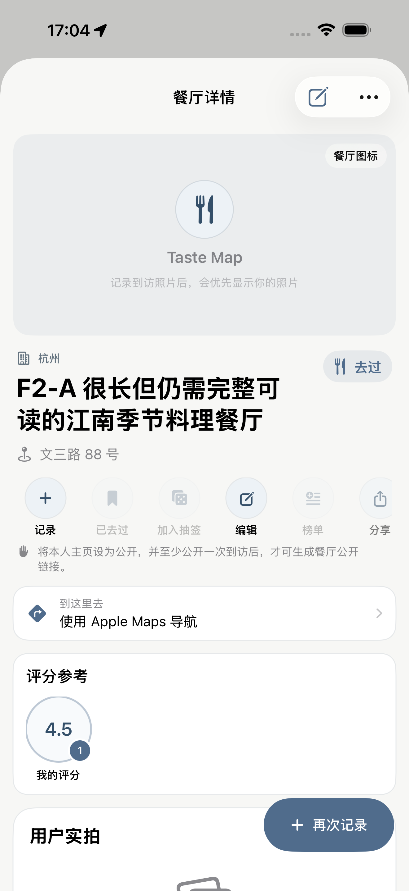
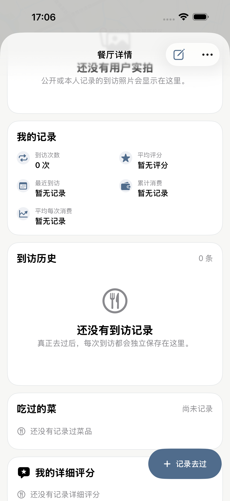
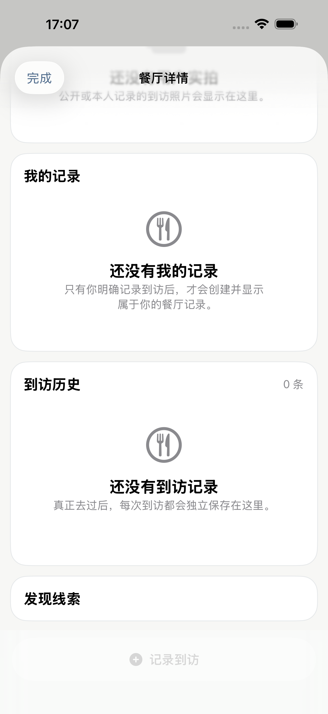
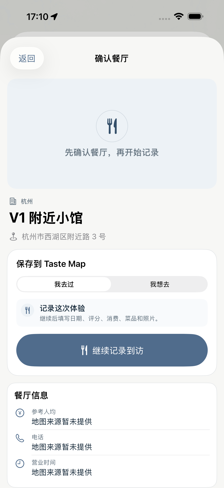

# Taste Map Product / UX Correction — Task 04 Acceptance

## Result

**PASS** — the existing global Restaurant Detail architecture remains the single source of truth, while its visible information architecture has been restored to the approved compact Web-derived order. No Restaurant data model, sync, authentication, Worker, D1, signing, or Production configuration changed.

## Git baseline

- Branch: `fix/product-ux-correction-8-tasks`
- Task baseline: `c8bbccbd444ae913a2d269eb768fc8e192ab6162`
- Task commit message: `Restore Restaurant Detail information architecture`

## Step A — product semantics verified before layout work

- `RestaurantDetailView` is the local/editable shell.
- `RestaurantDetailStandardBody` is the common Restaurant Detail body.
- Remote/read-only Discovery, Community, public-profile, and public-share paths reuse the same body; they do not maintain separate look-alike detail pages.
- Search, Nearby, external share, and Manual Add show the standard body in candidate-preview mode before an explicit `想去` or `去过` action creates local state.
- `RestaurantDetailEntrySource` affects navigation/analytics context only. It does not select a different body layout.
- Rating references remain distinct: mine, all users, friends, and same-taste. Missing scores or missing samples are omitted instead of being rendered as zero.
- The existing large score circle and small sample-count circle semantics were retained.

## Step B — information architecture restored

The shared body now follows this order:

1. Cover / hero
2. City and visited/want-to-go state
3. Restaurant name
4. Address
5. Lightweight primary actions
6. Reference spend
7. Phone
8. Opening hours
9. Compact Apple Maps navigation row
10. Rating reference
11. My rating
12. All-user rating
13. Friend rating
14. Same-taste rating
15. User photos
16. My visit overview
17. Visit history
18. Dishes and detailed-rating downstream content

### Specific corrections

- Replaced the tall two-row action card with one horizontally scrollable row of consistent 44-point circular actions.
- Preserved the action set: record, visited/want-to-go state, roulette, edit, lists, share, and more.
- Removed the 180-point static map from the location section. `到这里去` is now a compact business-information row that opens Apple Maps.
- Reduced business-information padding and visual weight in Restaurant acquisition preview and public-sharing surfaces.
- Changed the persistent visit action from a large full-width bar to a compact trailing capsule while retaining a 44-point hit target.
- Kept rating references above photos and personal visit history.

## Cross-entry component matrix

| Entry | Resolution | Shared body | Permission difference only | Status |
|---|---|---:|---:|---|
| Map | Local `RestaurantDetailView` | Yes | Yes | PASS |
| List | Local `RestaurantDetailView` | Yes | Yes | PASS |
| Search | Candidate preview, then local detail | Yes | Yes | PASS |
| Nearby | Candidate preview, then local detail | Yes | Yes | PASS |
| Discovery | Remote body or resolved local detail | Yes | Yes | PASS |
| Community | Remote body or resolved local detail | Yes | Yes | PASS |
| Public Profile | Remote body or resolved local detail | Yes | Yes | PASS |
| Lists | `RestaurantDetailView` with entry source | Yes | Yes | PASS |
| Analytics | `RestaurantDetailView` with entry source | Yes | Yes | PASS |
| Roulette | `RestaurantDetailView` with entry source | Yes | Yes | PASS |
| On This Day | `RestaurantDetailView` with entry source | Yes | Yes | PASS |
| Public Share | Public shell around standard body | Yes | Yes | PASS |

The unit matrix explicitly covers every formal `RestaurantDetailEntrySource` value so a future entry cannot silently introduce a second subject model.

## Screenshot evidence

### Before

### After — shared upper body

### After — local downstream content

### After — remote/read-only downstream content

### After — Restaurant acquisition preview using the same base body

## Automated verification

- `RestaurantDetailCompletionTests`: **23 passed**.
- `RestaurantDetailTests` + `RestaurantAcquisitionTests`: **31 passed**.
- Core layout parity UI evidence: **passed**.
- Local editable cross-entry UI path: **passed**.
- Community/public-profile remote cross-entry UI path: **passed**.
- Restaurant acquisition preview UI path: **passed**.
- Debug iPhone Simulator build: **BUILD SUCCEEDED**.
- Release iPhone Simulator build: **BUILD SUCCEEDED**.

An initial UI run exposed that the compact location wrapper no longer surfaced its accessibility identifier. The wrapper was corrected with an accessibility container; the exact failed paths then passed on retry. This was a real accessibility regression fix, not a relaxed assertion.

## Safety boundaries

- Restaurant/Visit/Photo/Dish models: unchanged.
- Sync/auth/import: unchanged.
- Worker/D1/migrations: unchanged.
- Signing, Team, Bundle Identifier, capabilities: unchanged.
- Production: not accessed.

## Remaining manual acceptance

No functional blocker remains. Final real-iPhone acceptance should confirm only platform presentation details: Dynamic Type wrapping in the horizontal action row, the physical Apple Maps handoff, and the compact sticky action position above the device tab/home-indicator area.
