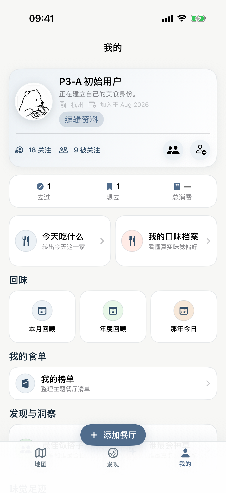
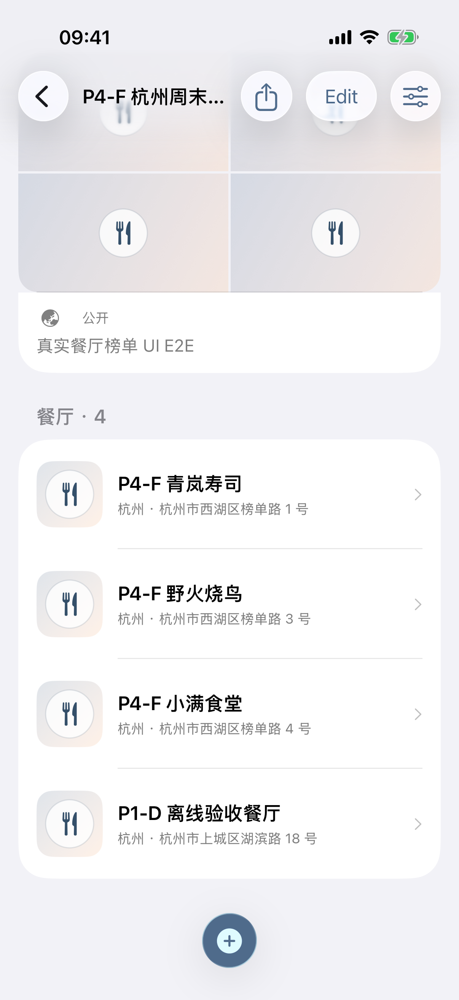
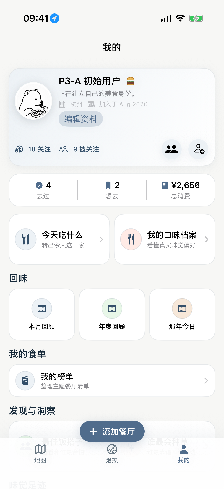
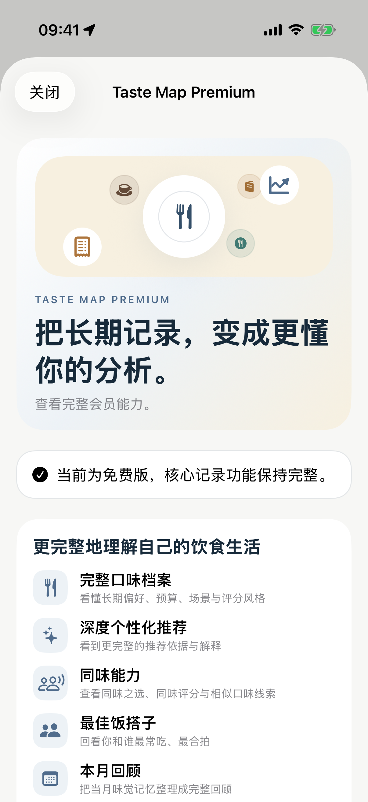

# Taste Map Product / UX Correction — Task 05 Acceptance

## Result

**PASS** — Profile now preserves the approved compact dashboard topology, `我的食单` contains the real Lists product instead of duplicate status lists, `味觉足迹` remains independently accessible, Lists retains its complete local-first flow, and Premium keeps the previously approved hamburger while replacing ad-hoc food emoji with the shared Food & Dining visual library.

No Restaurant/Visit/List/Premium data model, sync, authentication, Worker, D1, signing, or Production configuration changed.

## Git baseline

- Branch: `fix/product-ux-correction-8-tasks`
- Task baseline: `7ea941a101de623cda13274c4d0e430bc074eb8c`
- Task commit message: `Restore Profile Lists and Premium presentation`

## Step A — product semantics verified before layout work

- `去过` is the number of distinct visited Restaurants, not the number of Visits.
- `想去` is the number of active Restaurants whose status is `wantToGo`.
- `总消费` is the sum of non-`nil` `Visit.myActualSpend` values only; an unrecorded spend is not treated as zero-valued evidence.
- `关注 / 被关注` continues to come from the paginated social API and deduplicates user identities.
- `我的榜单` remains the real `RestaurantList` product with create, edit, add/remove, reorder, visibility, restart persistence, and public presentation behavior.
- `味觉足迹` is the Visit timeline. It is not another Restaurant list and is therefore not nested inside `我的食单`.
- Premium entitlement state and purchase-provider behavior are unchanged. The approved hamburger badge remains the historical Premium identity asset.

## Step B — Profile topology restored

The logged-in Profile retains this product order:

1. Compact identity header: avatar, name, city/join date, edit action, Premium state.
2. Following / follower relationships.
3. One horizontal statistics row: `去过 / 想去 / 总消费`.
4. Paired primary entrances: `今天吃什么 / 我的口味档案`.
5. `回味`: `本月回顾 / 年度回顾 / 那年今日`.
6. `我的食单`: the real `我的榜单` entry only.
7. `发现与洞察`: `最佳饭搭子 / 谁最会种草`.
8. `味觉足迹`: an independent Visit timeline entrance.
9. Settings as a secondary system entrance.

The former duplicated `去过的餐厅 / 想吃的餐厅 / 味觉足迹` card inside `我的食单` was removed. The top `去过` and `想去` statistics remain navigable, so the functionality was not deleted or hidden.

## Lists

- Fixed the Profile Lists accessibility hierarchy so the parent section no longer swallows the actual `profile-restaurant-lists-entry` control.
- The empty state now uses the shared `FoodDiningVisualLibrary` menu visual as an explicitly decorative fallback.
- The complete own-list UI E2E still passes: create, add multiple Restaurants, reorder, edit, remove, public view, and restart persistence.
- No list ownership, visibility, ordering, persistence, API, or sync semantics changed.

## Premium branding

- `PremiumBurgerBadge` and its `web-approved-hamburger-v1` contract are unchanged.
- The paywall hero no longer renders a free-form system emoji collage.
- Its decorative composition now uses shared Food & Dining kinds (`food`, `drink`, `tableware`, `menu`, `receipt`) with the established Premium palette.
- These motifs are decorative and make no claim about the current user's real taste data.
- StoreKit configuration, product identifiers, entitlement logic, purchase, restore, and server verification were not changed.

## Screenshot evidence

### Profile — light

### Profile — dark

### Lists — public ranking flow

### Premium — approved hamburger

### Premium — paywall

## Automated verification

- `ProfileListsMemoriesParityTests`: **passed**, including current-user isolation, unique-Restaurant count, nullable-spend semantics, social pagination, list persistence/order, and Premium visual contracts.
- `P4FRestaurantListTests`: **passed**.
- `P4HPremiumEntitlementTests`: **passed**.
- Profile light layout UI evidence: **passed**.
- Profile/Discovery dark-mode evidence: **passed**.
- Approved Premium hamburger UI evidence: **passed**.
- Free/paywall/development-upgrade UI flow: **passed**.
- Profile → visited/want/lists/footprints UI path: **passed**.
- Full own-list create/add/reorder/edit/remove/public/restart E2E: **passed**.
- Debug iPhone Simulator build: **BUILD SUCCEEDED**.
- Release iPhone Simulator build: **BUILD SUCCEEDED**.

The first list E2E run was flaky while presenting its third add sheet. An exact isolated retry on the same fixed iPhone 17 Pro Simulator passed the complete unmodified E2E path. No product assertion was weakened.

## Fixed Simulator preview workflow

- Fixed device: `iPhone 17 Pro` (`E4F3EED9-89D8-405C-B4CB-7CA816CE3405`).
- Debug build targeting that exact UDID succeeded.
- No Clone Simulator was created for the retry; UI parallel testing is disabled for subsequent work.
- At the post-build visual checkpoint, CoreSimulator reported the device as Booted but its install/SpringBoard service did not respond. The device was deliberately not erased, shut down, or replaced. Screenshot evidence above comes from the exact fixed device UI run immediately preceding that system-service stall.

## Restaurant image policy carried into the remaining tasks

Task 05 does not invent Restaurant imagery. The newly confirmed cross-app contract is now part of Tasks 06–08 acceptance:

1. local user Restaurant photo;
2. authorized public/cached Restaurant photo;
3. legally usable provider merchant image;
4. shared Food & Dining visual only when none of the above exists.

Provider results without a legally usable image will use the honest fallback. Decorative Food & Dining art must never cover an available real Restaurant image.

## Safety boundaries

- SwiftData schema: unchanged.
- Restaurant/Visit/List/Premium business models: unchanged.
- Sync/auth/import: unchanged.
- Worker/D1/migrations: unchanged.
- StoreKit configuration: unchanged.
- Signing, Team, Bundle Identifier, capabilities: unchanged.
- App Icon: unchanged.
- Production: not accessed.

## Remaining manual acceptance

No Task 05 functional blocker remains. Real-iPhone acceptance should later confirm Dynamic Type wrapping in the compact header/statistics and StoreKit presentation under the eventual real App Store Connect configuration. The fixed Simulator installation service must recover before the next live checkpoint can replace the currently displayed build; this is an environment gate, not a code failure.
