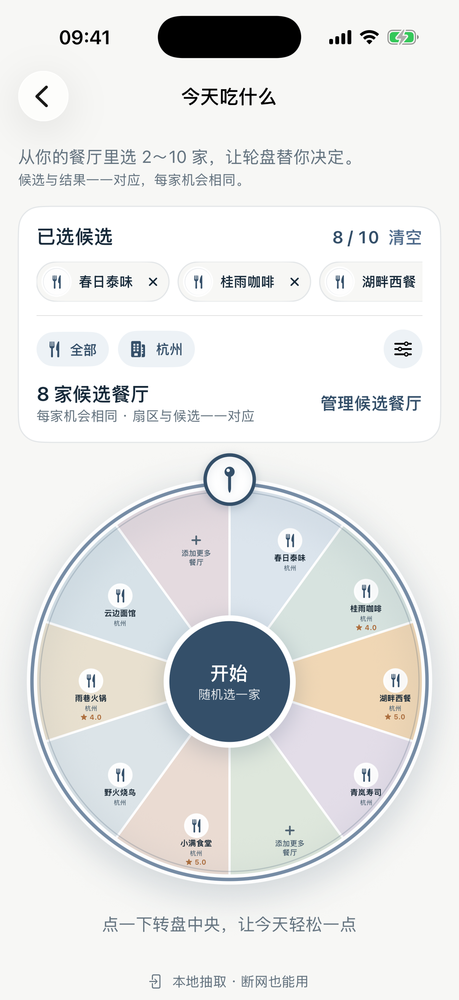
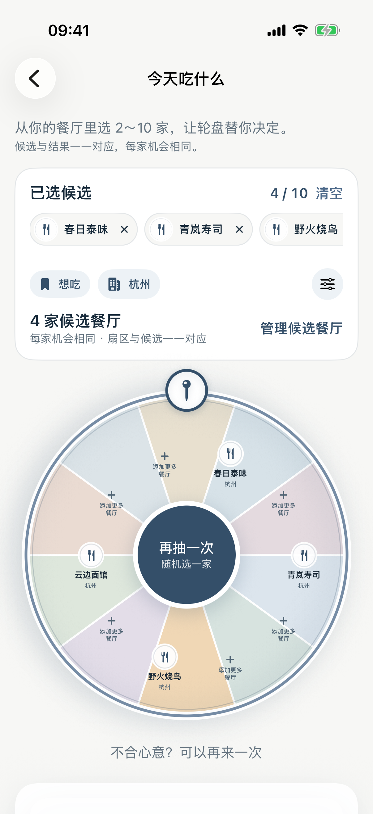
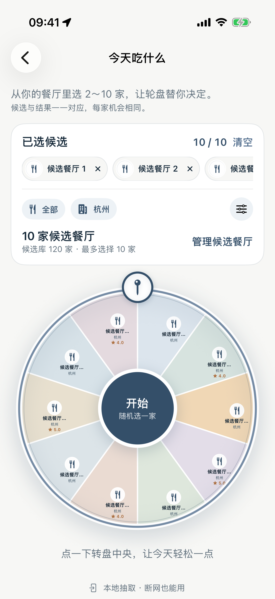
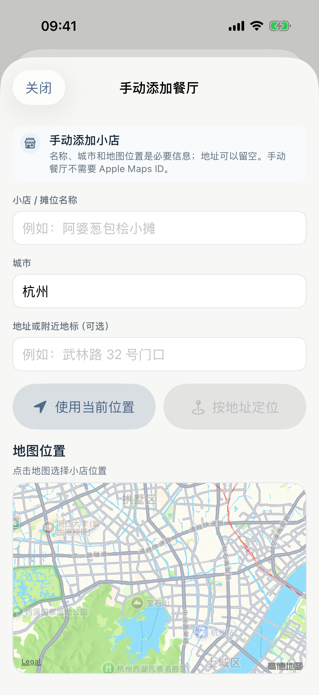

# Taste Map Product / UX Correction — Task 06 Acceptance

## Result

**PASS** — `今天吃什么` now restores the approved Web/product structure: one compact candidate area, real removable Restaurant chips, a one-to-one wheel/result contract, honest unfilled slots, a complete candidate manager, and a route into the existing official manual Restaurant acquisition flow.

No Restaurant/Visit schema, random weighting, sync, authentication, Worker, D1, signing, StoreKit, or Production configuration changed.

## Git baseline

- Branch: `fix/product-ux-correction-8-tasks`
- Task baseline: `6557e8649964df82e3c310d3e479d79887aa0d4d`
- Required task commit message: `Restore Web Roulette structure`

## Product semantics verified before layout work

- The random pool and visible wheel use the same selected Restaurant identities.
- Every selected Restaurant has equal probability; there is no rating, status, visit-count, or hidden recommendation weighting.
- Immediate re-roll avoids only the immediately previous result when more than one candidate exists.
- A one-Restaurant pool returns that Restaurant directly instead of displaying a fake spin.
- Candidate pools are deduplicated by stable global Restaurant identity and retain current-user ownership filtering from the existing Profile scope.
- **SUPERSEDED by the current Roulette contract in `docs/TASTEMAP_PRODUCT_DESIGN_RULES.md`:** a user-entered name is now an honest local temporary Roulette candidate. It does not create or impersonate a saved Restaurant, fabricate an image, or expose a fake detail page. Formal Restaurant creation remains a separate action.
- Candidate/result data remain local-first and usable offline.

## Main-page structure restored

1. Compact title and two-line product explanation.
2. A single `已选候选` panel containing removable real Restaurant chips, source/city conditions, candidate count, and one `管理候选餐厅` entry.
3. One wheel whose visual slots exactly correspond to the selected random pool.
4. Result card and `再抽一次` behavior.
5. A concise local/offline capability note.

The former duplicated candidate-count/filter cards were consolidated. The separate toolbar filter control was removed, leaving one unambiguous filter entry inside the candidate panel.

## Candidate manager

- Search within the current user's Restaurants.
- Segmented `全部 / 去过 / 想吃` source filter.
- Real Restaurant avatar/name/status/city rows.
- Select/deselect with an enforced maximum of 10.
- `应用当前结果` explicitly commits the draft selection.
- **SUPERSEDED:** `添加自定义餐厅` adds a local temporary candidate to the same pool/chips/wheel/result. `创建正式餐厅记录` is the separately named route into the existing manual-add product flow.
- Cancel does not partially apply a draft selection.

## Wheel and result contract

- 2–9 candidates use ten visual positions, with every unused position rendered as `+ 添加更多餐厅`.
- 10 candidates use ten real one-to-one segments.
- No Restaurant is copied to fill an empty slot.
- No decorative placeholder is eligible for random selection.
- Pointer geometry maps a selected candidate to that candidate's real visual slot.
- Light wheel slices use fixed dark ink in both Light and Dark appearance, preventing the former light-text-on-light-slice failure.
- Existing haptics, Reduce Motion behavior, offline draw, result detail navigation, re-roll, and restart persistence remain intact.

## Restaurant image priority

Task 06 establishes one explicit, tested source policy for Restaurant-facing visuals:

1. current user's local Restaurant photo;
2. authorized public/cached Restaurant photo reference;
3. legally usable HTTPS provider merchant image;
4. `FoodDiningVisualLibrary` only when no real image is available.

The policy is now applied to Roulette chips, wheel segments, results, local Map/List browsing, and taste-footprint list presentation. Existing Discovery, Restaurant Detail, and public Lists already follow photo reference → merchant image → honest fallback behavior. Apple Maps results without a legally reusable merchant image continue to show the honest fallback; no merchant image is fabricated.

The Web AMap reference pipeline remains the source contract: it preserves the first usable provider `poi.photos[].url` as `merchantImageUrl`. The iOS provider contract decodes only valid HTTPS values, while local user photos remain higher priority.

## Screenshot evidence

### Web reference

### Fixed Simulator — final wheel with honest empty slots

### Result and re-roll

### 120-Restaurant library constrained to ten real selections

### Candidate manager routes to official manual add

## Automated verification

- `P4GRestaurantRouletteTests` + `MapBrowsingParityTests`: **22 passed, 0 failed**.
- Covered 2/5/10 candidate geometry, honest unused slots, stable pool/visual/result mapping, uniform selection, immediate-repeat avoidance, source/city filters, local photo/provider/fallback priority, restart state, and invalid/deleted Restaurant exclusion.
- Focused Roulette UI suite: **5 passed, 0 failed**.
- Covered candidate manager/search/source filter/custom flow, empty pool, single candidate, 4-candidate filtered pool, result/detail/re-roll/restart, and 120-Restaurant library with ten real candidate segments.
- Debug fixed iPhone 17 Pro Simulator build: **BUILD SUCCEEDED**.
- Release generic iPhone Simulator build: **BUILD SUCCEEDED**.

## Fixed Simulator checkpoint

- Device: `iPhone 17 Pro` (`E4F3EED9-89D8-405C-B4CB-7CA816CE3405`).
- The same booted Simulator was used throughout; no Clone was created, no erase was performed, and the device was not shut down.
- The final Debug product was installed and launched from this task's worktree.
- The Simulator is intentionally left displaying the final `今天吃什么` wheel for immediate visual review.

## Safety boundaries

- SwiftData schema: unchanged.
- Restaurant/Visit business semantics: unchanged.
- Sync/auth/import: unchanged.
- Worker/D1/migrations: unchanged.
- Signing, Team, Bundle Identifier, capabilities: unchanged.
- App Icon: unchanged.
- Production: not accessed.

## Remaining manual acceptance

- Real iPhone should later confirm haptic feel and Reduce Motion under the user's actual Accessibility setting.
- Provider merchant images depend on the provider legally supplying a usable HTTPS URL; an absent provider image intentionally remains an honest Food/Dining fallback.
