# Taste Map Product / UX Correction — Task 07 Acceptance

## Result

**PASS** — the five formal Analytics experiences now use one approved Analysis visual system across both the in-App analysis pages and their independent 9:16 share posters:

- 我的口味档案
- 最佳饭搭子
- 谁最会种草
- 本月回顾
- 年度回顾

This task reused and completed the existing `TasteMapAnalysisTheme` and poster implementations. It did not create a third visual language, change any analytics calculation, alter SwiftData, or touch Worker/D1/Production.

## Git baseline

- Branch: `fix/product-ux-correction-8-tasks`
- Task baseline: `0d33f92e9e53d6fccf1fab9650ca58e9f1e39e22`
- Required task commit message: `Unify analytics pages and share posters`

## Product semantics verified before visual integration

- Every page continues to derive conclusions from the existing current-user Restaurant and Visit inputs.
- Optional ratings, spend, companions, recommendation sources, timestamps, and Restaurant relationships retain their previous nil-safe calculation rules.
- Decorative Food/Dining imagery is never presented as a measured preference.
- Data-linked Food Heroes and Restaurant evidence use the existing analysis output: cuisine/preference signals, representative Restaurants, visit histories, companion histories, recommendation-source histories, and recap periods.
- No sample content was introduced into the production runtime; fixtures remain test/Preview-only.

## Unified page contract

Each of the five analysis pages now presents:

1. a compact analysis identity and evidence-based headline;
2. one prominent `生成分享海报` call to action;
3. a central Food Hero;
4. surrounding analysis nodes, labels, and connecting lines;
5. supporting Restaurant/story evidence where the real dataset provides it;
6. honest sparse/empty states where the dataset cannot support a conclusion.

The redundant top-toolbar share controls were removed. The page remains a readable interactive analysis, while the poster remains a separately rendered social asset rather than a screenshot of the page.

## Share-poster contract

- All five poster families use the same maintained 9:16 canvas language: warm paper, central Food Hero, receipt/label/tape details, restrained Food/Dining accents, and an explicit evidence hierarchy.
- Poster rendering still uses the native SwiftUI `ImageRenderer` pipeline and the existing save/system-share flow.
- `SharePosterBrandFooter` is shared across all poster families and provides a consistent Taste Map brand mark, product name, optional supporting line, and QR location.
- The footer attempts to load the official App Icon asset first. The current AppIcon asset catalog contains no configured image filenames, and this task was prohibited from modifying App Icon; therefore the footer currently uses the honest Taste Map dining-brand fallback instead of inventing an icon.
- `SharePosterBrandConfiguration` accepts only a configured HTTPS public URL. It rejects credentials, query/fragment-bearing URLs, localhost/loopback, `workers.dev`, TestFlight URLs, and Development hosts in Production.
- No official public share URL is currently configured, so Release correctly omits the QR instead of encoding a fake or Development URL.

## Restaurant image priority

Analytics pages and posters now follow the same Restaurant-facing image order as the rest of the corrected product:

1. current user's real local Restaurant photo;
2. authorized public/cached Restaurant photo;
3. legally usable HTTPS provider merchant image;
4. `FoodDiningVisualLibrary` fallback only when no real Restaurant image is available.

Analysis inputs now carry the existing `merchantImageUrl` contract, and `AnalysisPosterImageResolver` can resolve both local photo assets and size-bounded HTTPS provider images. This prevents decorative Food/Dining art from covering an available real Restaurant image. Apple Maps or other providers without a legally reusable image continue to fall back honestly; no merchant image is fabricated.

## Screenshot evidence

### 我的口味档案

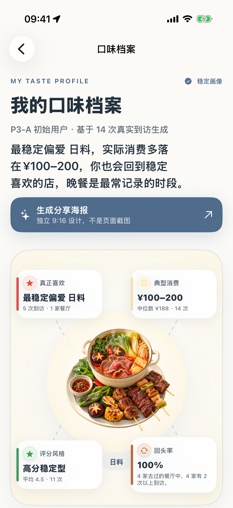

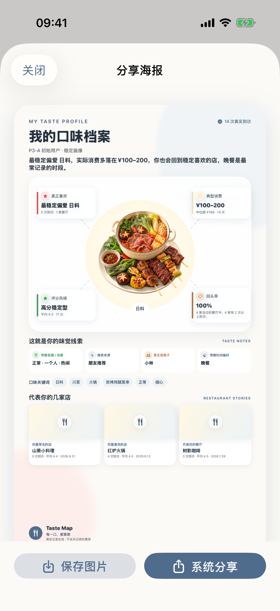

### 最佳饭搭子

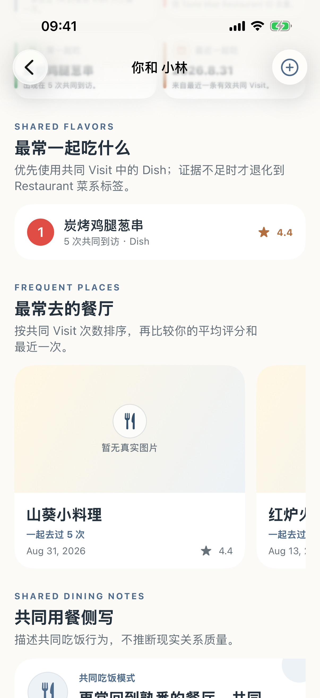

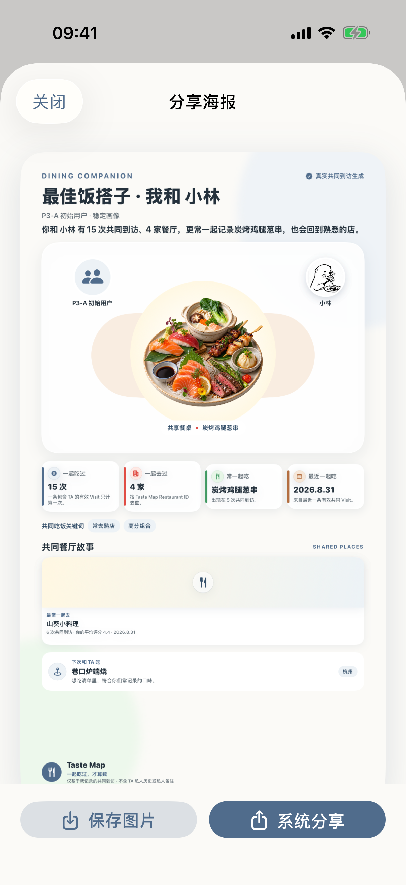

### 谁最会种草

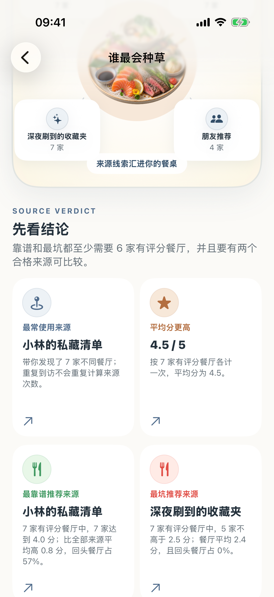

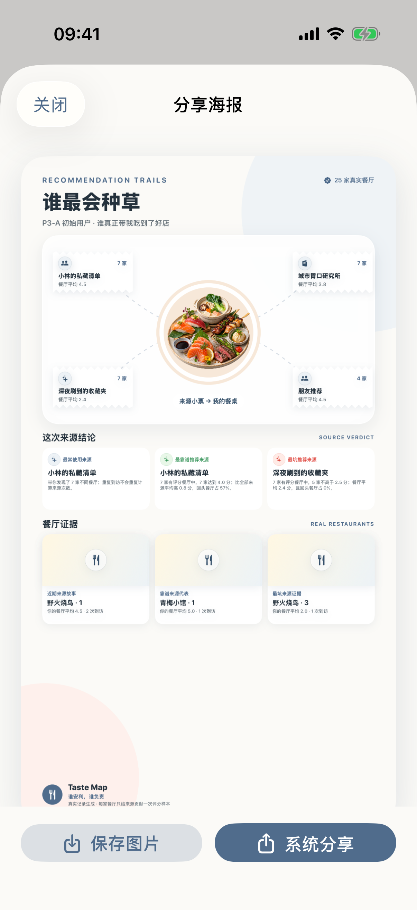

### 本月回顾

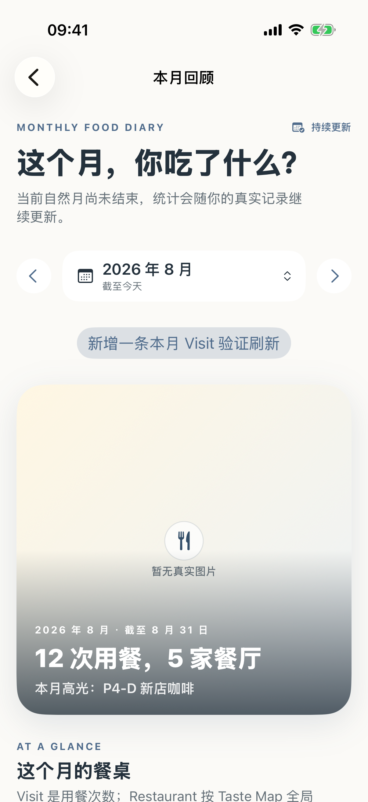

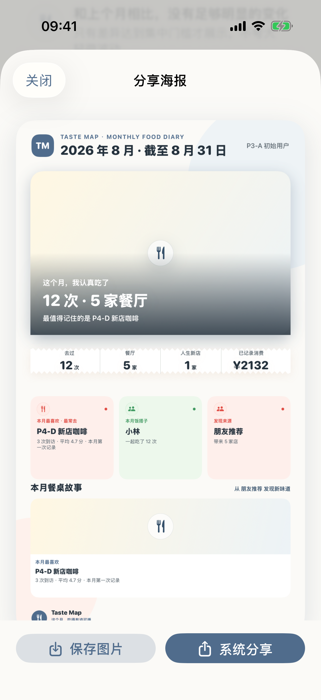

### 年度回顾

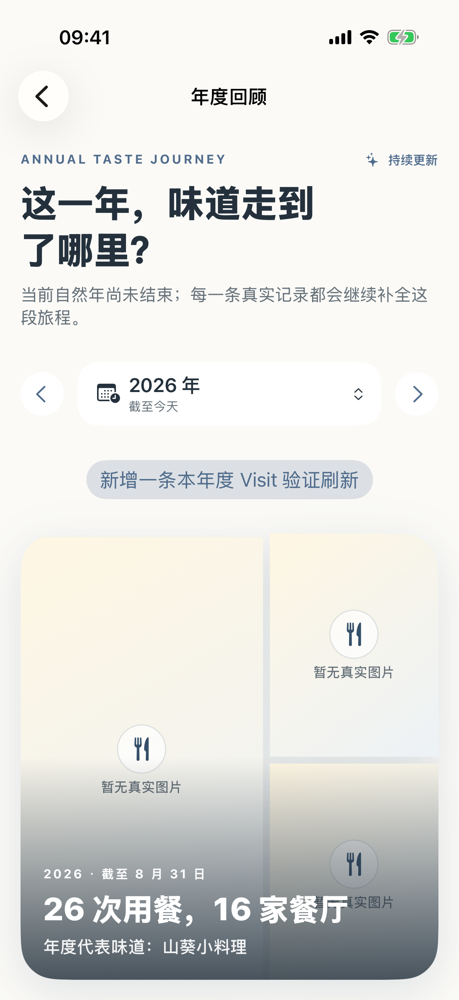

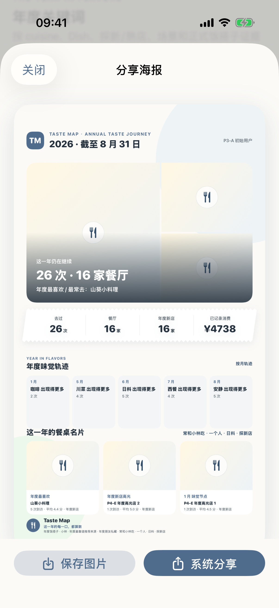

### Fixed Simulator checkpoint

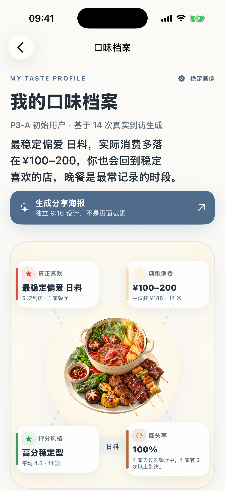

## Automated verification

- Focused unit/integration suites: `AnalysisVisualParityTests`, `P4ATasteProfileTests`, `P4BDiningCompanionTests`, `P4CRecommendationSourceTests`, `P4DMonthlyRecapTests`, and `P4EAnnualRecapTests`: **110 Swift Testing checks plus the P4E XCTest suite passed**.
- Added coverage for stable provider-image references, local-photo-over-provider precedence, safe share-URL validation, Development/Production fail-closed behavior, and QR rendering.
- All five current Analytics UI paths passed on the fixed Simulator after adapting the UI test navigation to the intentionally removed toolbar buttons.
- Debug iPhone 17 Pro Simulator build: **BUILD SUCCEEDED**.
- Release generic iPhone Simulator build: **BUILD SUCCEEDED**.

## Fixed Simulator workflow

- Device: `iPhone 17 Pro` (`E4F3EED9-89D8-405C-B4CB-7CA816CE3405`).
- The same Simulator remained booted throughout; no Clone was created, no erase was performed, and no alternate device was selected.
- The final Debug product was built from this worktree, installed, launched, and intentionally left on `我的口味档案` so the latest visual checkpoint is immediately visible.

## Safety boundaries

- Analytics calculation semantics: unchanged.
- SwiftData schema: unchanged.
- Sync/auth/import: unchanged.
- Worker/D1/migrations: unchanged.
- Signing, Team, Bundle Identifier, and capabilities: unchanged.
- App Icon: unchanged.
- Production: not accessed.

## Remaining manual/release gates

- A confirmed official public share URL is still required before Production QR branding can appear.
- The official App Icon source must be supplied/configured in the existing AppIcon set by the separate approved App Icon workflow; this task did not manufacture or replace it.
- A real iPhone should later confirm the system Save/Share interaction and final poster readability on physical display. The independent poster rendering itself is covered by the Simulator UI paths and generated-image evidence above.
