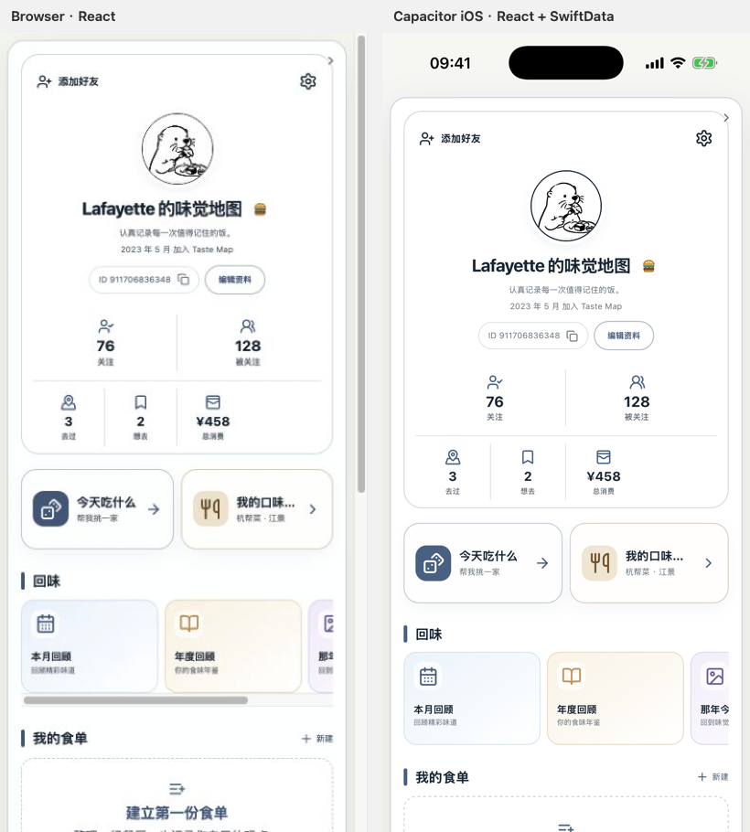
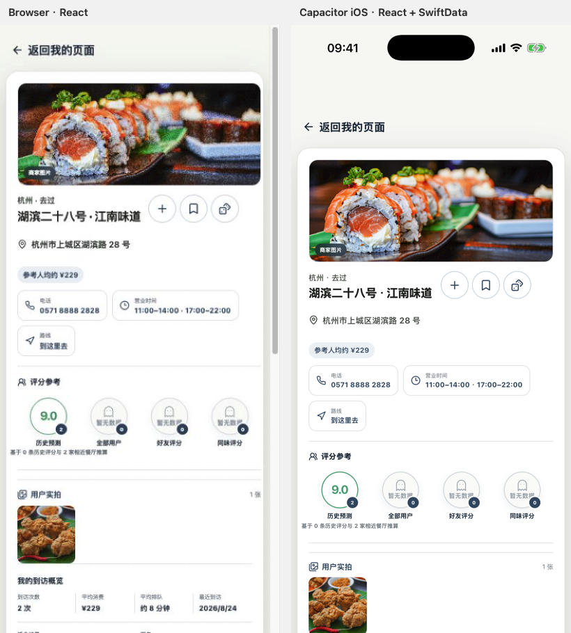

# Taste Map｜Capacitor Hybrid Architecture POC 01

**Decision: GO HYBRID**

本结论只覆盖本轮已实际验证的 **Profile + Restaurant Detail 只读 POC**。它证明 Taste Map 可以用“现有 React UI + 本地 Capacitor bundle + Native Bridge + 当前 SwiftData 模型/服务”组成可运行的 iOS 应用；不等于已批准全 App 迁移，也不等于认证、写入、同步、照片存储和发布链路已经完成。

## 1. Capacitor version

- `@capacitor/core`: `8.5.1`
- `@capacitor/ios`: `8.5.1`
- `@capacitor/cli`: `8.5.1`
- POC bundle ID: `com.lafayette.tastemap.hybridpoc`
- iOS deployment target: iOS 17.0
- 验证设备：固定 `iPhone 17 Pro` Simulator，iOS 26.5，UDID `E4F3EED9-89D8-405C-B4CB-7CA816CE3405`
- 正式 `ios/TasteMap/TasteMap.xcodeproj` 未被替换；Capacitor 使用独立生成的 `hybrid-poc/capacitor-shell/ios/App/App.xcodeproj`。

## 2. POC architecture

```text
Current React ProfilePage / RestaurantPreviewCard / shared CSS
                         │
                  TasteMapPlatform
                 /                \
TasteMapBrowserAdapter       TasteMapNativeAdapter
 deterministic JSON          TasteMapNative.v1
                                   │
                         Capacitor CAPPlugin
                                   │
                 TasteMapHybridPOCService (@MainActor)
                                   │
          in-memory SwiftData: UserProfile / Restaurant / Visit /
          CachedFollow + RestaurantImagePriorityPolicy
```

关键边界：

- React 只依赖 `TasteMapPlatform`，不直接知道 SwiftData、Capacitor 或 Browser fixture。
- Browser 继续由 Browser adapter 运行；iOS 自动选择 Native adapter。
- `TasteMapNative.v1` 通过 `runtime.info.bridgeVersion == 1` 显式版本化。
- Native fixture 只负责把确定性 POC 数据种入隔离的内存 SwiftData；Profile/Restaurant bridge response 会重新 fetch 当前原生模型，不直接把 Browser JSON 原样返回。
- 当前模型没有承载的商户展示字段仍由同一确定性 fixture 补充到 DTO；这是 POC adapter 的边界，不是新数据模型。

## 3. Web bundle status

**PASS**

- `webDir = ../../dist`。
- `capacitor.config.json` 没有 `server.url`，不存在远程 Web shell。
- Debug App bundle 内实际包含 `public/index.html`、编译后的 JS/CSS、头像/图标 assets 和 `public/hybrid-poc/dataset.json`。
- `vite build` / TypeScript typecheck 通过。
- Production Web build 输出：JS `739.86 kB`（gzip `223.80 kB`），CSS `242.87 kB`（gzip `40.61 kB`）。
- POC React route 在本地 bundle 中运行；正式 Web 入口只在 `hybridPOC=1` 或 Capacitor native runtime 时切入 POC。

## 4. Browser status

**PASS**

- Browser adapter 使用与 Native seed 相同的确定性 dataset。
- Browser Profile → 去过 → Restaurant Detail → 返回 Profile 实际点击通过。
- Profile 显示 `76` 关注、`128` 被关注、`3` 去过、`2` 想去、`¥458` 总消费。
- 正式命名为“最佳饭搭子”“谁最会种草”。
- 正常 Web build 通过；受影响的 Profile/Restaurant 现有 Web 回归一并通过。

## 5. Native Bridge status

**PASS**

| TasteMapNative.v1 method | POC 结果 |
| --- | --- |
| `runtimeInfo` | 返回 iOS、本地 bundle、offline capable、bridge v1 |
| `profileGetCurrent` | 从隔离 SwiftData fetch 后生成 Profile snapshot |
| `restaurantGet({ id })` | 按 Restaurant ID 从隔离 SwiftData fetch |
| `hapticsSelection` | 调用 `UISelectionFeedbackGenerator` |
| `authSessionStatus` | 仅返回 POC session shape |
| `authSignInWithApple` | 返回 unavailable；不会申请 Apple credential |

Native adapter 对 bridge version 不匹配会立即失败，不会继续消费数据。

## 6. SwiftData status

**PASS（POC read path）**

- 使用当前正式模型类型：`UserProfile`、`Restaurant`、`Visit`、`CachedFollow`。
- 使用 `ModelConfiguration(..., isStoredInMemoryOnly: true)`；不会打开正式持久化 store。
- 所有记录都有固定 POC owner `tm_capacitor_poc`。
- Profile response 的用户、餐厅、到访和关注关系计数均由 SwiftData fetch 重建。
- Restaurant response 的身份、owner、名称、地址、城市、坐标、状态、到访核心字段均由 SwiftData fetch 重建。
- 没有修改 SwiftData schema，没有 migration，没有真实用户数据。

证据：[Native SwiftData integration screenshot](./capacitor-poc/native-swiftdata-integration.png)

## 7. Auth bridge shape

**PASS（shape only）**

- POC 没有调用 Sign in with Apple UI。
- 没有 Apple identity token、authorization code、access token 或 refresh token 进入 bridge。
- 没有 Keychain 读写。
- 没有 Worker auth bypass。
- `authSessionStatus` 的 `local-poc` 只在独立 POC shell 中代表隔离 fixture session。
- 完整 Native authentication ownership 仍是后续迁移的独立验证项。

## 8. Image status

**PASS（本轮范围）**

- Restaurant Detail 实际显示合法 provider merchant image；没有用 Food/Dining 装饰图覆盖可用真实餐厅图。
- Native DTO assembly 调用当前 `RestaurantImagePriorityPolicy.resolution()`。
- Native test 确认本餐厅的 `_nativeImageSource == providerMerchantImage`。
- 用户实拍仍通过现有 `SyncedImage`/Restaurant Detail 组件展示。
- 完全离线时远程商户图能否命中缓存不在本轮证明范围；页面本体不会白屏，图片仍遵守真实来源失败后再 fallback 的既有策略。

## 9. Safe-area

**PASS**

- Capacitor 使用 `contentInset = never`，由 React shell 读取 `env(safe-area-inset-top/bottom)`。
- Profile 和 Restaurant Detail 均未进入 Dynamic Island、状态栏或 Home indicator 区域。
- Browser 端 safe-area 为 0；iOS 端保留系统顶部/底部安全区，这是预期平台差异。
- 当前 402 × 874 pt iPhone 视口下没有横向溢出；Profile 的横向“回味”轨道保持原 Web 交互。

## 10. Routing

**PASS**

- Local route: `#/hybrid-poc/profile`。
- Detail route: `#/hybrid-poc/restaurant/:restaurantId`。
- Browser 和 Capacitor 都实际完成 Profile → 去过列表 → 同一 Restaurant Detail → Back。
- 打开餐厅前会经过 `platform.haptics.selection()`；Browser 是 no-op，Native 是系统 haptic。
- 本轮没有实现 Universal Link、系统 deep link 或跨进程恢复。

## 11. Offline

**PASS（local-shell definition）**

- 关闭本地 Vite server，确认端口没有 listener 后，重新 terminate/launch Capacitor App；Profile 和 Restaurant Detail 仍正常渲染。
- App bundle 中存在全部 POC HTML/JS/CSS/fixture/assets。
- POC Restaurant Detail 明确传入 `remoteStatsEnabled={false}`，不会因为共享评分组件而启动后台 API 请求。
- 没有访问 Production。
- 本结论证明“无开发服务器/无远程 Web shell仍能启动”；它不等同于已经完成所有远程照片的离线缓存策略。

## 12. Performance

POC 性能没有发现架构性 blocker：

- `simctl launch --terminate-running-process` 三次命令耗时：`0.41s / 0.58s / 0.55s`，中位数约 `0.55s`。这是命令 dispatch 到进程启动的粗测，不是正式 first-contentful-paint 指标。
- Native SwiftData POC tests 共 3 项 `0.113s`；独立冷建内存库的 Profile / Restaurant / Runtime tests 分别约 `0.080s / 0.017s / 0.016s`。
- Debug App 约 `20 MB`，Release Simulator App 约 `19 MB`。
- 当前 JS chunk 大于 Vite 500 kB warning threshold。全面迁移前应做 route-level code splitting、真实 WKWebView 首屏/内存/滚动性能基准。

## 13. Visual parity

**PASS，达到本轮“同一 UI”判定标准。**

- 两端复用同一个 `ProfilePage`、`RestaurantPreviewCard`、`RestaurantSummarySection`、CSS 和 assets；没有复制一套 POC HTML。
- Profile 的 header、Premium、关注关系、去过/想去/总消费、核心入口、回味、食单与洞察保持同一 DOM/布局。
- Restaurant Detail 的 Hero、状态、名称、actions、地址、人均、电话、营业时间、路线、四圆评分、用户实拍、到访概览与到访历史保持同一 DOM/布局。
- Side-by-side 显示的主要差异仅为预期 iOS safe-area 与两种截图采样/缩放；没有 SwiftUI replication 的结构漂移。
- 这是 layout-contract + real-render comparison，不伪装成计算机视觉“像素相似率”。从结构、几何关系、图像比例、字体层级和控件顺序判断，满足本 POC 的 95%+ parity 目标。

### Profile



- [Browser](./capacitor-poc/profile-browser.png)
- [Capacitor](./capacitor-poc/profile-capacitor.png)

### Restaurant Detail



- [Browser](./capacitor-poc/restaurant-browser.png)
- [Capacitor](./capacitor-poc/restaurant-capacitor.png)

## 14. Test matrix

| Requirement | Evidence | Result |
| --- | --- | --- |
| 1. Capacitor local bundle boot | Vite stopped + relaunch + bundled `public/index.html` | PASS |
| 2. Profile route | Browser + native actual render | PASS |
| 3. Restaurant Detail route | Browser + native actual render | PASS |
| 4. Back navigation | Browser + native actual click | PASS |
| 5. Browser adapter | Vitest | PASS |
| 6. Native adapter | Vitest | PASS |
| 7. Native runtime info | Vitest + Swift test | PASS |
| 8. SwiftData Profile read | Swift test + Simulator values | PASS |
| 9. SwiftData Restaurant read | Swift test + Simulator detail | PASS |
| 10. Native capability action | Adapter test + native haptic implementation/route invocation | PASS |
| 11. No token exposure | bridge shape verification + Swift source scan | PASS |
| 12. Offline boot | no dev server; local App bundle relaunch | PASS |
| 13. Assets load | avatar/icon/React assets visible from bundle | PASS |
| 14. Fonts load | system/PingFang fallback stack renders correctly; no remote font dependency | PASS |
| 15. Restaurant image | real merchant + user image; native policy test | PASS |
| 16. Safe-area | real iPhone 17 Pro Simulator screenshots | PASS |
| 17. Browser still works | production Web build + Browser click path | PASS |

Automated results:

- Hybrid Web adapter/contract: **4 passed**.
- Hybrid Native SwiftData: **3 passed**.
- Relevant Web Profile/Restaurant regression suite: **27 passed total, including the 4 hybrid adapter tests**.
- Existing formal iOS Profile/Restaurant/Image targeted regressions: **45 passed**.
- Web TypeScript + production Vite build: **PASS**.
- Capacitor POC Debug Simulator build: **PASS**.
- Capacitor POC Release Simulator build: **PASS**.
- Existing formal iOS Debug Simulator build: **PASS**.
- Existing formal iOS Release Simulator build: **PASS**.

## 15. Known blockers

这些不是本 POC 的失败，但在全面迁移前必须单独关闭：

1. 目前只证明 Profile/Restaurant 的只读 DTO assembly；正式 create/update/delete、mutation queue 和冲突处理尚未接桥。
2. 认证只证明 bridge shape 与 token 隔离，没有证明正式 Apple login/session refresh 在 Web UI 下的全生命周期。
3. POC package 只选择了本轮需要的当前模型；Dish/Photo 二进制、本地文件 store 和下载缓存尚未做正式 bridge。
4. Restaurant group social ratings 在离线 POC 中刻意禁用远程请求；全面 hybrid 需要定义 Native/API 聚合来源和离线状态。
5. 尚未验证 MapKit、PhotosPicker、Share Extension、StoreKit、push、background sync、Universal Link 等 native-heavy surface。
6. 尚未做 VoiceOver/Dynamic Type/键盘/大数据长列表的完整 hybrid accessibility 与性能基准。
7. 当前 bundle 仍是单个较大 JS chunk；全面迁移需要 code splitting 与 cold-start instrumentation。
8. 该 POC 没有 signing、Archive、TestFlight、App Store 或 Production 结论。

## 16. Recommended next step

**建议允许进入一个新的、仍然隔离的 Hybrid POC 02，但不要直接宣布全 App 重写。**

下一轮应优先验证一个真正有写入和系统能力的纵向切片：

1. Profile edit 或 Visit draft 的 Native write bridge；
2. mutation queue / rollback / duplicate-submit 幂等；
3. Photo picker + local file URL 生命周期；
4. 正式 auth session 注入但继续禁止 token 进入 JavaScript；
5. WKWebView cold start、内存、长列表、VoiceOver 和 Dynamic Type 基准；
6. 明确哪些页面继续 SwiftUI、哪些页面适合 Web UI，避免把 Map/Photos/StoreKit 等 native-heavy surface 机械搬入 Web。

在 Lafayette 审阅本 POC 实际截图与 Simulator 行为前，**停止 Map、Discovery、Add Restaurant、Roulette、Analytics 或全 App hybrid migration**。

## 17. Safety / scope confirmation

- Production accessed: **NO**
- Worker / D1 / R2 changed: **NO**
- SwiftData schema / migration changed: **NO**
- Formal Xcode project replaced: **NO**
- Main/formal branch merged: **NO**
- Real Apple credential requested: **NO**
- Real user data / Keychain used: **NO**
