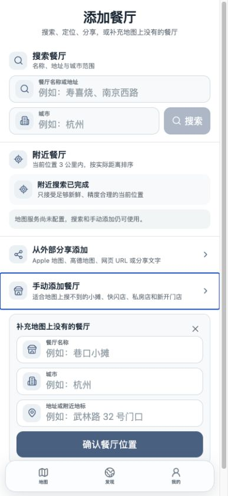
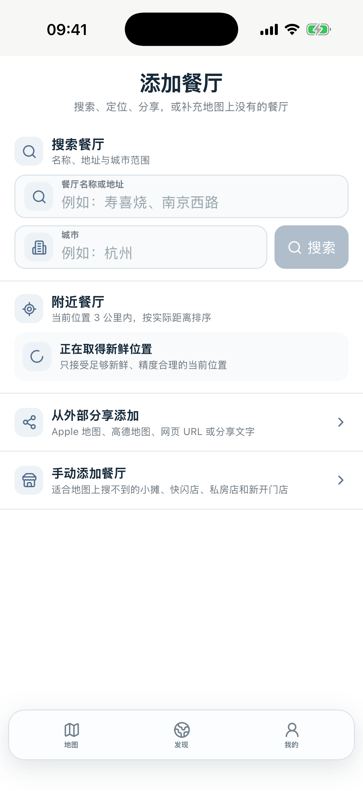
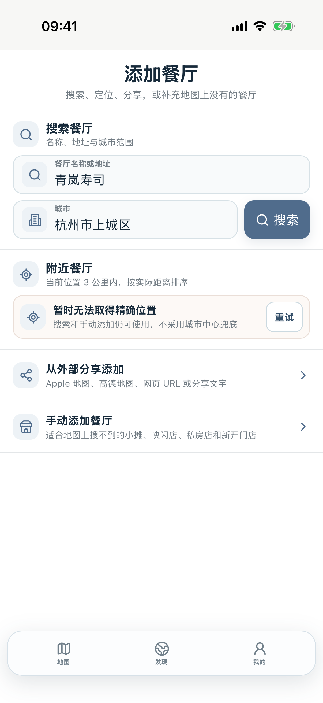

# Taste Map Add Restaurant Final Product + Visual Closure

Date: 2026-09-03

Branch: `feature/hybrid-remaining-ui-batch`

Scope: shared React Add Restaurant Product UI; no Production, schema, Sync, Worker/D1/R2, provider credential, or Batch 3 change.

## Source of truth

- `docs/TASTEMAP_PRODUCT_DESIGN_RULES.md`: Search → Nearby → Share ingestion → exactly one Manual Add; City is not GPS; candidates use canonical Restaurant Detail.
- `docs/TASTEMAP_HYBRID_ARCHITECTURE.md`: Browser and Capacitor share one React/CSS UI while platform adapters retain their legitimate capability differences.
- Historical/current evidence: `reports/full-product-parity-assets/web-add-restaurant-before.jpg`, `reports/full-layout-parity/final-atlas/full-parity-add-restaurant-nearby-after.png`, and the pre-closure Phase 2D capture.

## Root cause

The page shared only an outer scaffold. Browser and Hybrid still owned separate Search/City markup, Nearby-state markup, result rendering, and platform-specific CSS. The Hybrid inputs inherited sub-`16px` text, allowing WKWebView focus auto-zoom, while the split renderers accumulated different row heights, icons, focus feedback, candidate geometry, and expansion placement. Browser/Capacitor functional parity therefore existed only at capability-name level, not at the shared-component or visual-contract level.

## Regression inventory

| ID | Source | Current evidence | Expected | Resolution | Status |
| --- | --- | --- | --- | --- | --- |
| L1 | Lafayette | City/query focus could trigger WKWebView auto-zoom | Stable viewport with accessible user scaling | All acquisition text inputs use computed `16px`; viewport meta remains user-scalable | PASS |
| L2 | Lafayette | City lacked a sibling semantic icon | City/building semantics, never GPS | Shared Building/City icon container | PASS |
| L3 | Lafayette | Search did not speak the same visual language as Nearby/Share/Manual | One acquisition component family | Shared scaffold, header, input, status, result, and row tokens | PASS |
| L4 | Lafayette | Nested form/card styling looked like a Web form embedded in iOS | Compact native-density product surface | Removed duplicate/nested wrappers and flattened the hierarchy | PASS |
| L5 | Lafayette | Header, section, actions, and whitespace had uneven visual weight | Search primary; Nearby live capability; Share/Manual secondary | Rebalanced typography, rhythm, dividers, and CTA weight | PASS |
| C1 | Independent | Browser and Hybrid had separate Search/City JSX | One React UI | Both now consume `TasteMapRestaurantAcquisitionSearch` | PASS |
| C2 | Independent | Browser and Hybrid had separate result/candidate geometry | One canonical acquisition result renderer | Both consume `TasteMapRestaurantAcquisitionResults` | PASS |
| C3 | Independent | Nearby loading/error/content changed markup and section height | Stable compact state grammar | Shared `TasteMapRestaurantAcquisitionStatus` | PASS |
| C4 | Independent | Share/Manual icon containers, baselines, and hit geometry drifted | Consistent sibling treatment | Shared row/icon/pressed/focus tokens | PASS |
| C5 | Independent | Manual expansion lived outside the shared acquisition flow | One ordered scaffold | `manualPanel` is owned by the shared scaffold immediately after Manual | PASS |
| C6 | Independent | Supporting copy was too small/light at phone scale | Readable compact hierarchy | Raised helper/state/result typography while retaining density | PASS |
| C7 | Independent | Dismiss/compact action geometry could fall below the 44pt interaction contract | ≥44pt actual hit target | Shared controls retain compact visuals with bounded hit areas | PASS |
| C8 | Independent | Native browser focus/pressed visuals were inconsistent | Shared visible interaction feedback | Shared `focus-within`, active, disabled, and expanded state styles | PASS |
| C9 | Independent | Long city values and small-width layouts risked overflow | Truncation/flex containment without horizontal page scroll | Added `min-width: 0`, bounded grids, and 402pt overflow regression | PASS |

Total objective items closed: **14** (5 Lafayette-reported families + 9 independently discovered contract/visual issues).

## Final structure

1. Compact Add Restaurant header and one explanatory line.
2. Search capability with shared name/address and City controls plus one primary Search action.
3. Nearby capability with stable loading/content/error treatment and honest location semantics.
4. Lightweight external Share ingestion row.
5. Exactly one Manual Add row; expansion remains in the same visual flow.
6. Existing bottom navigation remains exactly `地图 / 发现 / 我的`.

No primary paste-link UI was added. Search/Nearby/Share candidates still route through the canonical Restaurant Detail; no minimal confirmation page or new write architecture was introduced.

## Browser ↔ Capacitor evidence

| Gate | Evidence | Result |
| --- | --- | --- |
| Product Contract | Four ordered capabilities, one Manual entry, no paste-link primary, canonical selection route | PASS |
| One React UI | Browser and Hybrid imports/assertions for the shared scaffold/search/status/results | PASS |
| Browser ↔ Capacitor visual parity | Same JSX/CSS; 402×874 Browser and iPhone 17 Pro captures below | PASS |
| Function / semantics | Query/city input, keyboard, Search, Nearby, Share, Manual and native adapter contracts | PASS |
| Negative contract | No legacy Hybrid search/result/status CSS, no `user-scalable=no` or `maximum-scale=1` | PASS |

### Browser Mobile after

### Browser Mobile Manual Add after

### Capacitor fixed-Simulator after

### Capacitor input-focus regression attachment

## Input-focus proof

- Fixed device: iPhone 17 Pro Simulator, iOS 26.5, UDID `E4F3EED9-89D8-405C-B4CB-7CA816CE3405`.
- Browser Mobile computed query font: `16px`; City font: `16px`; Manual fields: `16px`.
- Browser Mobile focus result: `visualViewport.scale = 1`, no horizontal overflow.
- XCUITest focused and typed both query and City fields, observed the software keyboard, dismissed it, and confirmed field widths stayed unchanged within 1 point.
- Search, Share, and Manual controls remained hittable after both focus transitions.

## Automated evidence

Recorded before final commit:

- Full Vitest unit/contract suite: **57 files, 401 tests PASS**.
- Focused `HybridGlobalProductContract` + `HybridRemainingUIContract`: **29/29 PASS**.
- TypeScript/Web/Worker typecheck: **PASS**.
- Browser production build: **PASS**.
- Hybrid Debug bundle and Debug Simulator build: **PASS**.
- Focused fixed-Simulator XCUITest: **PASS** (1 test, 0 failures; result bundle `build/add-restaurant-final-derived-data/Logs/Test/Test-TasteMap-2026.09.03_10-24-39-+0800.xcresult`).
- Hybrid formal Release bundle: **PASS**.
- iOS Release Simulator build: **PASS**.
- Generic iOS device Release build: **PASS**.
- Formal Release purity scan: **PASS** — 36 app files / 16 signed Web files; no Debug switch, fixture, Development URL, local path, secret, or credential surface in React.

## Remaining gates

- Real iPhone Location/provider/Share Extension smoke remains a release/manual capability gate.
- Exact final visual preference remains Lafayette Product Acceptance; there is no unresolved objective Product Contract gap in this module.
- The production owner remains SwiftUI. This work does not start Batch 3 or promote the surface to `HYBRID_PRIMARY`.
