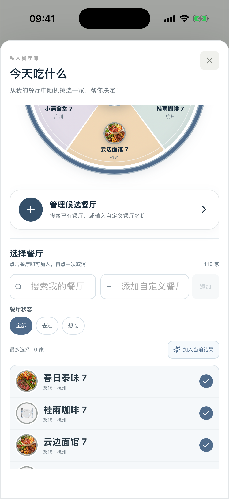

# Taste Map — Roulette 自定义候选餐厅验收

## 结果

**PASS** — `今天吃什么` 的候选管理区现在同时、明确展示：

- `搜索我的餐厅`
- `添加自定义餐厅`
- 独立 `添加` 操作

自定义名称会直接进入同一候选池、候选 chip、转盘扇区和抽取结果；它只是一条本地临时候选，不会伪造成正式 Restaurant，不会生成虚假商户图片或虚假 Restaurant Detail。

## 同类问题全局扫描

扫描了 Browser、Capacitor、Hybrid shared React、Native rollback、历史验收文档及测试。

- Browser 与 Capacitor 均消费 `RestaurantRoulette` 这一份 shared React UI；没有第二套 Hybrid Roulette 页面。
- Native rollback 原先把“添加自定义餐厅”错误指向正式建餐厅流程，已拆分为“临时候选”与“创建正式餐厅记录”两个不同语义。
- Native rollback 在先搜索、后添加自定义候选时会被旧搜索词隐藏，已在添加成功后清空过滤条件，保证新候选立即可见。
- 历史 Task 06 报告中的旧行为已明确标记为 `SUPERSEDED`，避免以后按过时规则再次实现。

## 产品合同

- 名称自动去除首尾空白，空名称拒绝添加。
- 与正式 Restaurant 或现有临时候选同名时拒绝重复添加。
- 与正式候选共用最多 10 家限制。
- 临时候选没有 `restaurantID`、商户图片或详情入口。
- 正式建餐厅仍经过既有 Manual Add 流程，不被临时候选行为替代。
- “管理候选餐厅”会把搜索/自定义输入滚动到当前可操作区域，而不是藏在转盘下方。

## 自动化验证

- Vitest 全量：62 files / 450 tests PASS。
- Hybrid Roulette product contract：11 tests PASS。
- Native `P4GRestaurantRouletteTests`：14 tests PASS。
- 固定 Simulator Hybrid UI interaction：自定义名称一次加入、chip 出现、候选数从 5/10 变为 6/10，PASS。
- Browser Mobile 402pt：输入、添加、去重、候选 chip、候选数量及转盘同步，PASS。
- Debug iOS Simulator build：PASS。
- Release iOS Simulator build：PASS。
- Formal staged bundle byte-for-byte verification：PASS（16 files）。
- Formal Release purity scan：PASS（40 app files / 16 signed Web files）。

## 固定 Simulator 视觉证据

- Device: iPhone 17 Pro / iOS 26.5
- UDID: `E4F3EED9-89D8-405C-B4CB-7CA816CE3405`
- App: Debug Rich Visual QA, Hybrid UI

## 未触碰范围

未修改 Restaurant/Visit 数据模型、Sync、Worker、D1/R2、Production、StoreKit、地图、转盘几何、随机权重或正式 Restaurant 创建数据流。
